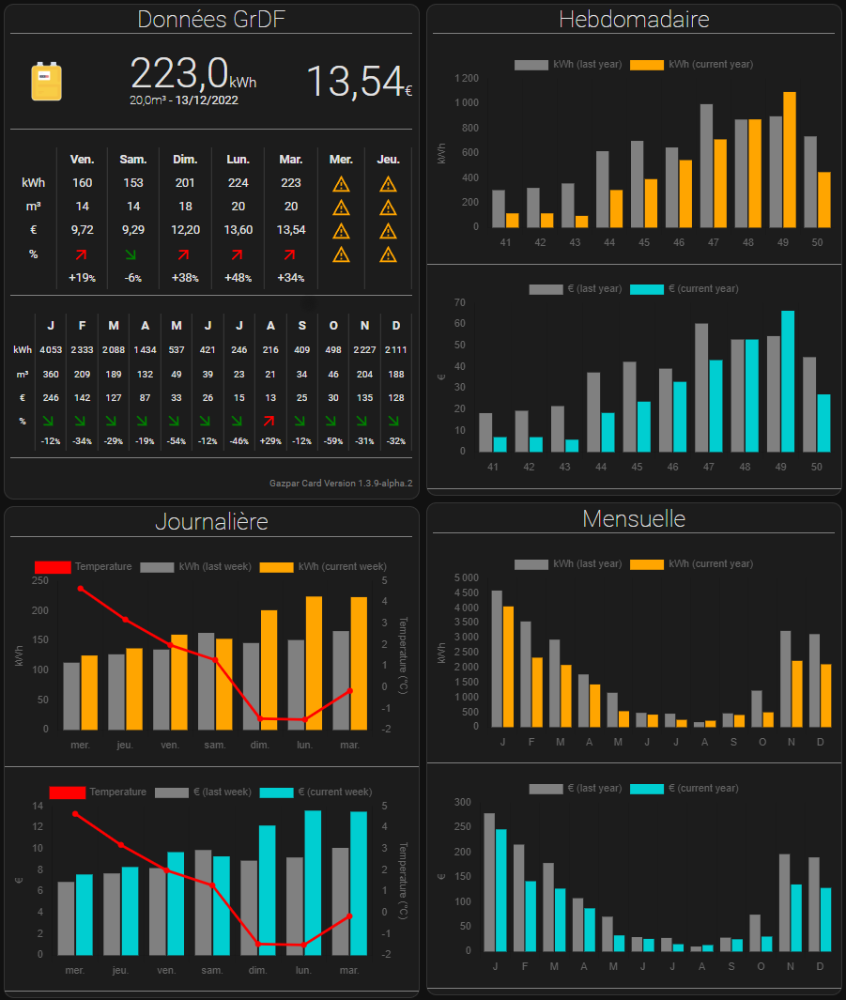
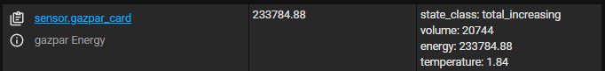
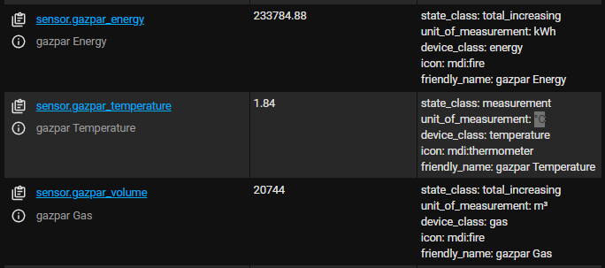

# Gazpar2MQTT

[](https://pypi.org/project/gazpar2mqtt/)
[](https://pypi.org/project/gazpar2mqtt/)
[](https://hub.docker.com/r/ssenart/gazpar2mqtt)
[](https://github.com/ssenart/gazpar2mqtt/actions/workflows/ci.yaml)
[](LICENSE)

Gazpar2MQTT is a gateway that reads the data of your GrDF (French gas provider) meter and publishes it to an MQTT message broker. It uses the [PyGazpar](https://github.com/ssenart/pygazpar) library to retrieve the GrDF data.

It is compatible with the [Lovelace Gazpar Card](https://github.com/ssenart/lovelace-gazpar-card) version 1.3.11-alpha.3 or later.



## Contents

- [Features](#features)
- [Requirements](#requirements)
- [Installation](#installation)
- [Usage](#usage)
- [Home Assistant Energy Dashboard integration](#home-assistant-energy-dashboard-integration)
- [FAQ](#faq)
- [Troubleshooting](#troubleshooting)
- [Security](#security)
- [Limitation](#limitation)
- [Development](#development)
- [Publishing a Docker image manually](#publishing-a-docker-image-manually)
- [Related projects](#related-projects)
- [Changelog](#changelog)
- [Contributing](#contributing)
- [License](#license)
- [Project status](#project-status)

## Features

- Reads the daily, weekly, monthly and yearly consumption from GrDF through [PyGazpar](https://github.com/ssenart/pygazpar).
- Publishes one retained JSON document per meter to MQTT (see [MQTT payload](#mqtt-payload)).
- Publishes Home Assistant MQTT discovery entities for the card, the energy, the volume and the temperature.
- Publishes an availability topic, set to `offline` when GrDF cannot be reached.
- Runs as a Home Assistant add-on, as a Docker container, as a Python package or from the source files.

## Requirements

- A GrDF account, and your meter identifier (PCE), which is shown in your GrDF account.
- An MQTT broker.
- Python 3.10 to 3.14, only when running the Python package or the source files. The Docker container and the Home Assistant add-on need no Python installation.
- Home Assistant, only to use the discovery entities.

## Installation

Gazpar2MQTT can be installed in many ways.

### 1. Home Assistant Add-on

In the **Add-on store**, click **⋮ → Repositories**, fill in **`https://github.com/ssenart/gazpar2mqtt`** and click **Add → Close** or click the **Add repository** button below, click **Add → Close** (You might need to enter the **internal IP address** of your Home Assistant instance first).

[](https://my.home-assistant.io/redirect/supervisor_add_addon_repository/?repository_url=https%3A%2F%2Fgithub.com%2Fssenart%2Fgazpar2mqtt)

For usage and configuration, read the documentation [here](addons/gazpar2mqtt/DOCS.md).

### 2. Using Docker Hub

The following steps permits to run a container from an existing image available in the Docker Hub repository.

1. Copy and save the following docker-compose.yaml file:

```yaml
services:
  gazpar2mqtt:
    image: ssenart/gazpar2mqtt:0.3.0 # Pin the version you install, so that each upgrade is deliberate
    container_name: gazpar2mqtt
    restart: unless-stopped
    network_mode: bridge
    user: "1000:1000"
    volumes:
      - ./gazpar2mqtt/config:/app/config
      - ./gazpar2mqtt/log:/app/log
    environment:
      - GRDF_USERNAME=<GrDF account username>
      - GRDF_PASSWORD=<GrDF account password>
      - GRDF_PCE_IDENTIFIER=<GrDF PCE meter identifier>
      - MQTT_BROKER=<MQTT broker ip adcress>
```

Edit the environment variable section according to your setup.

2. Run the container:

```sh
$ docker compose up -d
```

### 3. Using PIP package

```sh
$ cd /path/to/my_install_folder/

$ mkdir gazpar2mqtt

$ cd gazpar2mqtt

$ python -m venv .venv

$ source .venv/bin/activate

$ pip install gazpar2mqtt

```

### 4. Using Dockerfile

The following steps show you how to build the Docker image based on the local source files.

1. Clone the repo locally:

```sh
$ cd /path/to/my_install_folder/

$ git clone https://github.com/ssenart/gazpar2mqtt.git

$ cd gazpar2mqtt
```

2. Edit the docker-compose.yaml file by setting the environment variables corresponding to your GrDF account and MQTT setup:

```yaml
environment:
  - GRDF_USERNAME=<GrDF account username>
  - GRDF_PASSWORD=<GrDF account password>
  - GRDF_PCE_IDENTIFIER=<GrDF PCE meter identifier>
  - MQTT_BROKER=<MQTT broker ip adcress>
```

3. Build the image:

```sh
$ cp docker/docker-compose.yaml .
$ docker compose build
# Alternatively, force a full rebuild without cache, under another tag, to test a local build.
# Be sure to adapt the docker-compose.yaml accordingly.
$ docker image build . -f docker/Dockerfile --no-cache --progress=plain --tag ssenart/gazpar2mqtt:dev
```

4. Run the container:

(provided you have copied the docker-compose.yaml file to the current folder, as was done above)

```sh
$ docker compose up -d
```

This will run the container in detached mode, and use the local `./config` and `./log` folders for configuration and logging.

### 5. Using source files

The project requires [uv](https://docs.astral.sh/uv/) tool for dependency and package management.

```sh
$ cd /path/to/my_install_folder/

$ git clone https://github.com/ssenart/gazpar2mqtt.git

$ cd gazpar2mqtt

$ uv sync

$ source .venv/bin/activate

```

`uv sync` creates the `.venv` virtual environment from the versions locked in `uv.lock`. Activate it as above (`.venv\Scripts\activate` on Windows), or prefix the commands with `uv run`.

## Usage

### Command line

```sh
$ python -m gazpar2mqtt --config /path/to/configuration.yaml --secrets /path/to/secrets.yaml
```

### Configuration

The configuration is to be provided using two YAML files: a configuration file and a secret file. The latter is used to fill in the `!secret xxxxx` parts in the configuration file.

Both these files may or may not use environment variables.

The construction of the effective configuration works the same for all installation types (container, PIP package, source files...). In order to assist in debugging, the application will log, at startup, the effective configuration as constructed from the config file, the secret file, and any environment variables that are used.

#### Configuration files

The default configuration file is below.

```yaml
logging:
  file: log/gazpar2mqtt.log # Path to the log file. If not provided, logging to file is disabled, and logging to console will be enabled.
  console: true
  level: debug
  format: '%(asctime)s %(levelname)s [%(name)s] %(message)s'

grdf:
  scan_interval: ${GRDF_SCAN_INTERVAL} # Number of minutes between each data retrieval (0 means no scan: a single data retrieval at startup, then stops).
  devices:
  - name: gazpar
    username: "!secret grdf.username"
    password: "!secret grdf.password"
    pce_identifier: "!secret grdf.pce_identifier"
    last_days: ${GRDF_LAST_DAYS} # Number of days of data to retrieve

mqtt:
  broker: "!secret mqtt.broker"
  port: "!secret mqtt.port"
  username: "!secret mqtt.username"
  password: "!secret mqtt.password"
  keepalive: 60
  base_topic: gazpar2mqtt

homeassistant:
  discovery: true
  discovery_topic: homeassistant
  entities:
    card:
      device_class: energy
      enabled_by_default: true
      icon: mdi:fire
      state_class: total_increasing
      state_topic: "{{ mqtt_base_topic }}/{{ device_name }}"
      unit_of_measurement: kWh
      json_attributes_topic: "{{ mqtt_base_topic }}/{{ device_name }}"
      value_template: "{{ value_json.energy }}"

    energy:
      device_class: energy
      enabled_by_default: true
      icon: mdi:fire
      state_class: total_increasing
      state_topic: "{{ mqtt_base_topic }}/{{ device_name }}"
      unit_of_measurement: kWh
      value_template: "{{ value_json.energy }}"

    volume:
      device_class: gas
      enabled_by_default: true
      icon: mdi:fire
      state_class: total_increasing
      state_topic: "{{ mqtt_base_topic }}/{{ device_name }}"
      unit_of_measurement: "m³"
      value_template: "{{ value_json.volume }}"

    temperature:
      device_class: temperature
      enabled_by_default: true
      icon: mdi:thermometer
      state_class: measurement
      state_topic: "{{ mqtt_base_topic }}/{{ device_name }}"
      unit_of_measurement: "°C"
      value_template: "{{ value_json.temperature }}"
```

The default secret file:

```yaml
grdf.username: "${GRDF_USERNAME}"
grdf.password: "${GRDF_PASSWORD}"
grdf.pce_identifier: "${GRDF_PCE_IDENTIFIER}"

mqtt.broker: "${MQTT_BROKER}"
mqtt.port: "${MQTT_PORT}"
mqtt.username: "${MQTT_USERNAME}"
mqtt.password: "${MQTT_PASSWORD}"
```

If you use the container and do not provide a configuration file or secret file, the above default templates will be used automatically: they will be copied to wherever you map `/app/config` to, the first time you execute the container. You must in that case however make sure that the container has the correct access rights, in order to be able to write those files.

#### Environment variables

By default, the configuration files make use of the environment variables below:

| Environment variable | Description                                                                   | Required | Default value  |
| -------------------- | ----------------------------------------------------------------------------- | -------- | -------------- |
| GRDF_USERNAME        | GrDF account user name                                                        | Yes      | -              |
| GRDF_PASSWORD        | GrDF account password (avoid using special characters)                        | Yes      | -              |
| GRDF_PCE_IDENTIFIER  | GrDF meter PCI identifier                                                     | Yes      | -              |
| GRDF_SCAN_INTERVAL   | Period in minutes to refresh meter data (0 means one single refresh and stop) | No       | 480 (8 hours)  |
| GRDF_LAST_DAYS       | Number of days of history data to retrieve                                    | No       | 1095 (3 years) |
| MQTT_BROKER          | MQTT broker IP address                                                        | Yes      | -              |
| MQTT_BROKER          | MQTT broker port number                                                       | No       | 1883           |
| MQTT_USERNAME        | MQTT broker account user name                                                 | No       | ""             |
| MQTT_PASSWORD        | MQTT broker account password                                                  | No       | ""             |

It is however not mandatory to use these variables; you are free to rename them, or to not use them, as long as you adapt the configuration files accordingly.

If you use containers, environment variables are often the easiest way to provide secrets to the application.
You can setup them directly in a docker-compose.yaml file (environment section) or from a Docker command line (-e option).

### Expected behaviour

The following entities will be created in HA (using grdf.devices[].name and homeassistant.entities configuration):

- sensor.{grdf.devices[].name}_card: This entity is fully compatible with [lovelace-gazpar-card](https://github.com/ssenart/lovelace-gazpar-card). It has to be choosen in the card "Entity" configuration property.
- sensor.{grdf.devices[].name}_energy: Total energy consumption in kWh.
- sensor.{grdf.devices[].name}_volume: Total volume consumption in m³.
- sensor.{grdf.devices[].name}_temperature: Local temperature in °C.

The prefix {grdf.devices[].name} depends on what has been choosen as device name in configuration file.

Those 3 entities are visible in the "Developer Tools" (States tab) menu in HA:



### MQTT payload

Each device publishes its data as one JSON document on `{mqtt.base_topic}/{grdf.devices[].name}`, retained. The Home Assistant entities above read their values from it, and the other fields are available to automations and dashboards.

| Field | Content |
| ----- | ------- |
| `volume` | Latest meter index, in m³. |
| `energy` | Energy consumed up to the latest index, in kWh. |
| `temperature` | Latest local temperature, in °C. |
| `username`, `pce` | The GrDF account and the meter identifier. |
| `daily`, `weekly`, `monthly`, `yearly` | The readings of each frequency, most recent first. |
| `source`, `attribution`, `timestamp` | The application that published the data, the data provider's attribution, and the time of publication. |

Each reading in these arrays has the same keys, and a value the source does not give is `null`:

| Key | Content |
| --- | ------- |
| `time_period` | The period label, for example `09/05/2019` for a day. |
| `frequency` | `daily`, `weekly`, `monthly` or `yearly`. |
| `start_date`, `end_date` | The first and last day of the period. |
| `start_index_m3`, `end_index_m3` | The meter indexes at the start and at the end of the period, in m³. |
| `volume_m3`, `energy_kwh` | The volume and the energy consumed during the period. |
| `converter_factor_kwh/m3` | The factor that converts volume to energy. |
| `temperature_degC` | The temperature of the period, in °C. |
| `type` | `MES` for a measured reading, `Calculé` for a value computed from the meter indexes. |
| `timestamp` | When PyGazpar read the reading. |

Weekly readings follow the calendar week, so the week that straddles the new year is a week of its own. Some daily values can be computed from the meter indexes when GrDF has no reading for a day, and are then marked `Calculé`.

## Home Assistant Energy Dashboard integration

### Gazpar2HAWS

A new application [Gazpar2HAWS](https://github.com/ssenart/gazpar2haws) has been developed to feed the Home Assistant Energy dashboard.

It is capable of reconstructing the complete data history and keeping it up to date.

Dates are now synchronized with Home Assistant and costs can be calculated.

### Legacy method

Make sure the HA Recorder integration is configured correctly to record your reading values. Declare your sensor in the Gas section of the dashboard control panel.

## FAQ

- *Is it an official GrDF application ?*

  No, absolutely not. It was made by reverse engineering GrDF website without any guarantee of long-term operation. Indeed, any modification made to their website risks breaking it.

- *My PCE ID has a leading zero (e.g. "0123456789") and the application fails with an error indicating that the PCE number is unknown. I can see in the log file that it uses "123456789" without the leading zero. What happened ?*

  The cause is in your configuration file (grdf.devices[].pce_identifier) ​​where you configured your PCE identifier and you did not quote it. Your PCE number is then interpreted as a number instead of a string.

## Troubleshooting

Sometimes, for any reason, the application does not work as expected. No entities is created in HA, some error messages are displayed, nothing happens...

In this situation, the most valuable tool for troubleshooting what is happening is the log file.

Take a look at it, try to find a clue that might help solve the problem. Sorry, the log file can sometimes appear cryptic.

A common cause is an MQTT broker that refuses the connection. The application then stops with the following error, and no entities are created in HA:
```log
ERROR [root] MQTT broker refused the connection: Connection Refused: not authorised. (result code 5)
```
This means the broker rejected the credentials. Check `mqtt.username` and `mqtt.password` (or `MQTT_USERNAME` and `MQTT_PASSWORD`). Leaving them empty only works if your broker accepts anonymous connections. For example, the Mosquitto add-on requires a user to be defined.

If your configuration is correct, you may have spotted a bug.

In this case, capture a Github issue [here](https://github.com/ssenart/gazpar2mqtt/issues) with the following information:
1. What kind of setup do you use ? Standalone application, Docker container or HA addon.
2. Is this a first installation or a version upgrade ? If upgrading version, what was the previous version and did it work well ?
3. Describe as precisely as possible what is happening.
4. Provide the complete log file (from start to finish) and make sure to erase all your secrets from it.

The first log lines should be similar to:
```log
2025-02-17 02:00:45,617 INFO [__main__] Starting Gazpar2MQTT version 0.3.0
2025-02-17 02:00:45,619 INFO [__main__] Running on Python version: 3.12.9 (main, Feb  7 2025, 01:03:02) [GCC 12.2.0]
```

The normal last lines of the log should be:
```log
2025-02-17 10:01:55,805 INFO [root] Device 'gazpar' data published to MQTT.
2025-02-17 10:01:55,805 INFO [root] Publishing Home Assistant data to MQTT...
2025-02-17 10:01:55,806 INFO [root] Publishing Home Assistant device 'gazpar' with unique ID '0x2132a05910b42286'
2025-02-17 10:01:55,806 INFO [root] Publishing Home Assistant entity 'card' of device 'gazpar'
2025-02-17 10:01:55,811 INFO [root] Publishing Home Assistant entity 'energy' of device 'gazpar'
2025-02-17 10:01:55,814 INFO [root] Publishing Home Assistant entity 'volume' of device 'gazpar'
2025-02-17 10:01:55,818 INFO [root] Publishing Home Assistant entity 'temperature' of device 'gazpar'
2025-02-17 10:01:55,821 INFO [root] Home Assistant data published to MQTT.
2025-02-17 10:01:55,821 INFO [root] Gazpar data published to MQTT.
2025-02-17 10:01:55,821 INFO [root] Waiting 480 minutes before next scan...
```

## Security

- **Secrets.** The GrDF password and the MQTT password are secrets. Provide them through environment variables (Docker), through the add-on options (Home Assistant add-on), or through a secrets file (source files and Python package). Never commit them.
- **Git.** The repository ignores the `secrets.yaml` and `secrets.*.yaml` files. Only the `secrets.template.yaml` templates, which hold placeholders, are tracked.
- **Logs.** At startup, the application logs its effective configuration. The values of the keys whose name contains `password`, `secret` or `token` are masked. Review a log before you share it in an issue anyway.
- **MQTT.** The published document contains your GrDF username and your PCE identifier. Use a broker with authentication (`mqtt.username` and `mqtt.password`), do not expose it to the internet, and restrict who can subscribe to the topics under `mqtt.base_topic` (`gazpar2mqtt` by default).

## Limitation

Gazpar2MQTT depends on PyGazpar, which retrieves the data by reading the GrDF website. A change to that website can stop the data retrieval until PyGazpar is updated.

GrDF also makes the readings available with a delay of 2 to 5 days, or more. The most recent values are therefore not the consumption of the current day.

## Development

### Prerequisites

- Python 3.10 or higher (the CI tests 3.10 to 3.14).
- [uv](https://docs.astral.sh/uv/) 0.13 or higher.
- Git.
- Docker, only for the integration tests (they need an MQTT broker) and to build the image.

### Get the sources and set up the environment

```sh
$ git clone https://github.com/ssenart/gazpar2mqtt.git

$ cd gazpar2mqtt

$ uv sync
```

`uv sync` creates the `.venv` virtual environment with the application and the development tools (pytest, ruff, mypy), from the versions locked in `uv.lock`. Prefix the commands below with `uv run`, or activate the environment first (`source .venv/bin/activate`, or `.venv\Scripts\activate` on Windows).

To run the application from the sources, copy the templates in `config/`, fill in your GrDF and MQTT settings, then start it:

```sh
$ cp config/secrets.template.yaml config/secrets.yaml

$ uv run python -m gazpar2mqtt --config config/configuration.yaml --secrets config/secrets.yaml
```

### Project layout

| Path | Content |
|---|---|
| `gazpar2mqtt/` | The application package. |
| `tests/` | The tests, with their configuration in `tests/config/` and a Mosquitto configuration in `tests/containers/`. |
| `config/` | The configuration and secrets templates used at run time. |
| `docker/` | The Dockerfile, the entrypoint and the `docker-compose.yaml` sample. |
| `addons/` | The Home Assistant add-on. |
| `pyproject.toml`, `uv.lock` | The project metadata and the locked dependency versions. Commit `uv.lock` with every dependency change. |

### Check the code

```sh
$ uv run ruff format .          # format the code (the CI runs: ruff format --check .)

$ uv run ruff check .           # lint

$ uv run mypy .                 # check the types
```

### Run the tests

Four tests need no account and no broker. The four others are integration tests: they read your real GrDF data and publish it to a real MQTT broker.

| Test | Needs |
|---|---|
| `test_version`, `test_generate_objectid`, `test_run_succeeds_when_broker_accepts_connection`, `test_run_fails_when_broker_refuses_connection` | Nothing. |
| `test_run` (`test_bridge.py`), `test_publish` (`test_gazpar.py` and `test_homeassistant.py`), `test_main` | A secrets file with your GrDF account, and an MQTT broker on `127.0.0.1:1883`. |

Without a secrets file, the integration tests fail with `Secrets file 'tests/config/secrets.yaml' not found`. To run only the tests that need nothing:

```sh
$ uv run pytest -k "test_version or test_generate_objectid or broker"
```

To run all the tests, as the CI does:

1. Create the secrets file from the template. Either copy `tests/config/secrets.template.yaml` to `tests/config/secrets.yaml` and edit it, or fill it in from environment variables (`envsubst` comes with the `gettext` package):

   ```sh
   $ export GRDF_USERNAME='your login' GRDF_PASSWORD='your password' GRDF_PCE_IDENTIFIER='12345678901234'

   $ envsubst < tests/config/secrets.template.yaml > tests/config/secrets.yaml
   ```

2. Start a Mosquitto broker with the test configuration:

   ```sh
   $ docker run -d --name mosquitto-gazpar-test -p 127.0.0.1:1883:1883 \
       -v "$PWD/tests/containers/config:/mosquitto/config:ro" \
       --tmpfs /mosquitto/data --tmpfs /mosquitto/log eclipse-mosquitto:latest
   ```

   The CI uses `tests/containers/docker-compose.yaml`. Locally, prefer `docker run` as above: the compose file mounts `tests/containers/data` and `tests/containers/log`, where the container creates files owned by root inside your working copy.

3. Run the tests, then stop the broker:

   ```sh
   $ uv run pytest

   $ docker rm -f mosquitto-gazpar-test
   ```

The test log is written to `log/pytest.log`.

**The secrets file holds your real credentials and must never be committed.** Git ignores every `secrets.yaml`, `secrets.*.yaml`, `secrets.env` and `*.secrets` file, whatever its folder; only the `secrets.template.yaml` templates are tracked, and they contain placeholders only. Keep your credentials out of the templates, and check `git status` before you commit.

### Manage the dependencies

```sh
$ uv add paho-mqtt              # add a dependency of the application

$ uv add --group dev pytest-cov # add a development tool

$ uv lock --upgrade-package pyyaml  # upgrade one locked package

$ uv sync --locked              # install exactly what uv.lock says (the CI does this)
```

### Build

```sh
$ uv build                      # the wheel and the sdist, in dist/

$ docker build -f docker/Dockerfile -t ssenart/gazpar2mqtt:dev .
```

### Continuous integration and releases

The CI workflow runs on every push: it checks the formatting, lints, checks the types, and runs the tests on Python 3.10 to 3.14.

Releases are made with the **Create Release** workflow (GitHub Actions, run manually). It takes the version to release, and the branch it runs on decides which kind of version is accepted: an alpha such as `0.5.1a4` on `develop`, a beta or a release candidate such as `0.5.1b1` or `0.5.1rc1` on a `release/0.5.1` branch, and a final version such as `0.5.1` on `main`. All of them are published to PyPI; a run from a `feature/*` branch publishes to TestPyPI instead. Use its dry-run option first. The workflow:

- checks the version against the branch, requires it to be greater than every existing tag, and checks the CI status of the commit;
- bumps the version in `pyproject.toml`, `uv.lock` and the add-on files, so do not bump it by hand;
- turns the `[Unreleased]` section of `CHANGELOG.md` into the released version, and uses it as the release notes;
- builds the package, publishes it to PyPI (or TestPyPI), publishes the Docker image (the `latest` tag only for a final version), then commits the bump, tags it and creates the GitHub release.

Add an entry under `[Unreleased]` in `CHANGELOG.md` for every change visible to the users: the workflow refuses to release when that section is empty. The manual way to publish a Docker image is described in the next section.

## Publishing a Docker image manually

The **Create Release** workflow publishes the Docker image of every release (see [Continuous integration and releases](#continuous-integration-and-releases)). Use the steps below only as a manual fallback.

1. Build the image:

```sh
$ docker compose build
```

2. Tag the image with the version number:

```sh
$ docker image tag ssenart/gazpar2mqtt:latest ssenart/gazpar2mqtt:<version>
```

3. Log in to Docker Hub:

```sh
$ docker login
```

4. Push the tags to publish. Push `latest` only for a final version. Name each tag explicitly: `--all-tags` pushes every local tag of the image.

```sh
$ docker push ssenart/gazpar2mqtt:<version>
```

The images are available [here](https://hub.docker.com/repository/docker/ssenart/gazpar2mqtt/general).

## Related projects

Gazpar2MQTT offers the same functionality as [home-assistant-gazpar](https://github.com/ssenart/home-assistant-gazpar), but runs outside Home Assistant.

| Project | Role |
| ------- | ---- |
| [PyGazpar](https://github.com/ssenart/pygazpar) | Python library that retrieves the GrDF data. |
| [home-assistant-gazpar](https://github.com/ssenart/home-assistant-gazpar) | Home Assistant integration that provides the energy sensor. It is compatible with the Lovelace Gazpar Card. |
| [Lovelace Gazpar Card](https://github.com/ssenart/lovelace-gazpar-card) | Lovelace card that displays the history as tables or bar charts. It is compatible with Gazpar2MQTT. |
| [Gazpar2HAWS](https://github.com/ssenart/gazpar2haws) | Feeds the Home Assistant Energy dashboard from the Recorder. It timestamps each reading on its observation date, reconstructs up to 3 years of history and computes energy costs. |

## Changelog

The changes of each version are listed in [CHANGELOG.md](CHANGELOG.md). Releases are published on the [GitHub releases page](https://github.com/ssenart/gazpar2mqtt/releases).

## Contributing

Pull requests are welcome. For major changes, please open an issue first to discuss what you would like to change.

Please make sure to update tests as appropriate.

See the [Development](#development) section to set up the environment and to run the checks and the tests.

## License

[MIT](https://choosealicense.com/licenses/mit/)

## Project status

Gazpar2MQTT has been initiated for integration with [Home Assistant](https://www.home-assistant.io/).

Since it relies on MQTT, it can be used with any other Home Controllers that works with MQTT technology.

A compatible Home Assistant Lovelace Card is available [here](https://github.com/ssenart/lovelace-gazpar-card)

An alternative is using Home Assistant integration custom component available [here](https://github.com/ssenart/home-assistant-gazpar).

